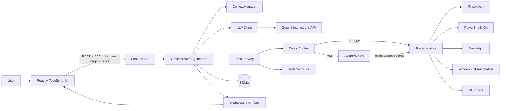

# Proposed Architecture

## Scope

This is the proposed final architecture from `SPEC.md`, adjusted for the current empty repository. It is design documentation, not an assertion that these components already exist.



## Responsibilities and boundaries

| Component | Owns | Must not do |
|---|---|---|
| React UI | Chat, task timeline, approvals, settings, trace display | Store the Gemini key or execute laptop actions |
| FastAPI | HTTP/SSE, token/origin checks, request validation | Contain agent reasoning |
| Agent loop | Task lifecycle and repeated reasoning/tool-result steps | Call executors directly or import the Gemini SDK |
| `LLMClient` | Gemini request/response adaptation and error mapping | Know tool implementation or policy rules |
| Context manager | The context sent for each model step | Become persistent memory |
| Tool gateway | Validation, policy, approval, execution, structured result, audit | Be bypassed |
| Policy engine | ALLOW/ASK/DENY decisions | Be controlled by model output |
| Executors | Concrete filesystem, terminal, browser, desktop, and MCP work | Decide authorization |
| SQLite repositories | Tasks, tool calls, approvals, conversation/memory records as introduced | Become an implicit permission bypass |

## Request-to-action sequence

1. The user submits text to `POST /api/chat`.
2. FastAPI authenticates the session token, validates origin, creates a task, and schedules the background loop.
3. `agent/loop.py` builds context and calls the internal `LLMClient`.
4. A final model answer completes the task; a tool call is emitted as an event and sent to `tools/gateway.py`.
5. The gateway validates Pydantic arguments before policy evaluation.
6. Policy returns ALLOW, ASK, or DENY. ASK suspends the task and sends the exact tool and arguments to the UI for approval.
7. An approved exact argument hash is executed by the registered executor. The result always uses the structured `ToolResult` contract.
8. The result, including errors and denials, returns to the loop for the next model step. Events and redacted audit records are persisted or published as specified by the current phase.

## Planned directory boundaries

```text
backend/
  main.py
  api/              # HTTP and SSE endpoints
  agent/            # loop, state, prompts, context
  llm/              # LLMClient, Gemini adapter, fake client
  tools/            # definitions, registry, gateway, executors
  policy/           # risk and permission decisions
  events/           # in-process event bus
  db/               # SQLite and migrations
  security/         # origin, token, paths, secrets, redaction
  audit/
frontend/           # React + TypeScript + Vite
tests/              # unit, integration, security, agent
docs/               # phase-by-phase learning documentation
```

## Key security properties

- Bind only to `127.0.0.1`.
- Require a random session token and validate allowed origins for API and event streams.
- Keep the Gemini key in backend configuration; scrub it from child-process environments and logs.
- Treat files, web pages, command output, screenshots, and similar external content as untrusted data.
- Enforce allowed roots and Windows path restrictions before filesystem execution.
- Require approval for medium/high-risk operations and deny critical operations by default.
- Make the gateway the only route to tools.

## Architecture risks

The highest-risk seams are cancellation while approval is pending, exact-argument approval binding, Windows path/junction handling, subprocess tree termination, prompt injection through tool results, and keeping model/API details out of orchestration code. These should receive focused tests as their phases are built.

