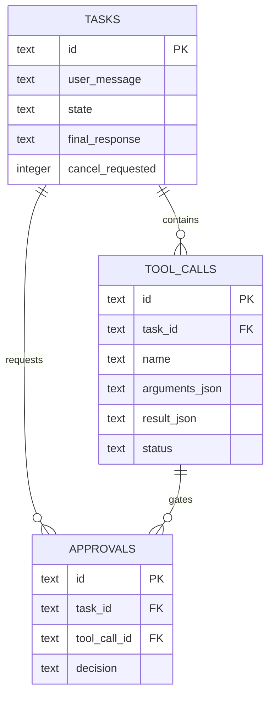

# Database — Phase 4

## Schema

## Migration strategy

The project uses plain, ordered SQL migrations. `backend/db/database.py` creates `schema_migrations`, applies each unapplied file in filename order, and records its version. Phase 4 adds `002_tasks.sql`; `TaskManager` uses this runner rather than creating a second schema path.

## Why SQLite

The agent is a local Windows application. SQLite provides durable task state and inspectable data without Redis, PostgreSQL, or a separate service. The design is not intended for multi-user remote deployment.

## Data and privacy

Task messages, tool arguments, results, and approvals are local application data. Phase 4 does not yet implement the full redacted audit trail or retention policy; those are later responsibilities. Never put API keys or passwords into task text.

