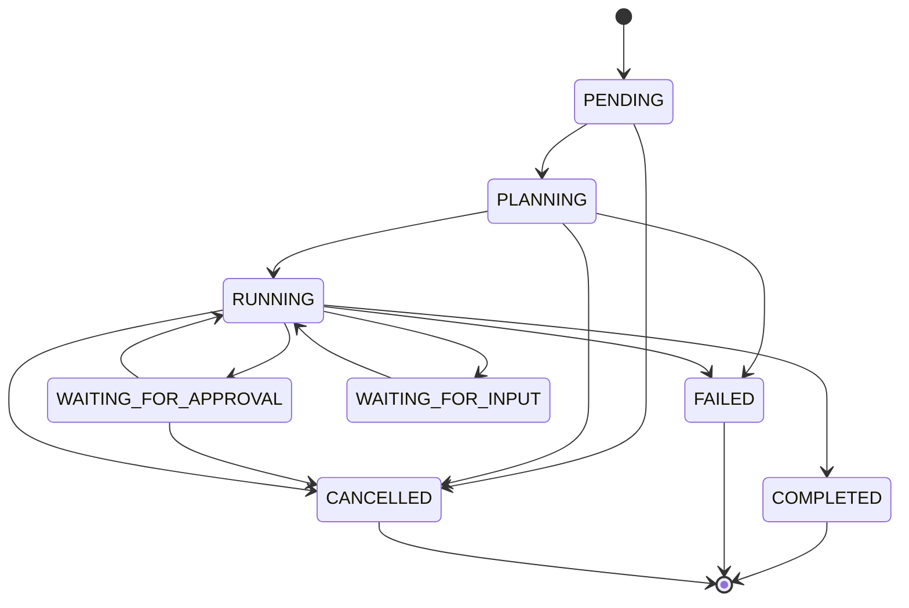

# Tasks — Phase 4

## State machine

`backend/agent/state.py` is the single transition table. Illegal transitions raise `ValueError`; terminal states have no outgoing transitions.

## Persistence

`TaskManager` stores tasks, tool calls, and approvals in SQLite. The `002_tasks.sql` numbered migration is applied by the existing migration runner. The in-memory `Task` cache makes the active loop convenient while SQLite remains the source of truth for API inspection.

## API routes in this phase

| Method | Path | Purpose |
|---|---|---|
| POST | `/api/chat` | Create a task and schedule its loop |
| GET | `/api/tasks` | List task details |
| GET | `/api/tasks/{id}` | Inspect state, tool calls, and approvals |
| POST | `/api/tasks/{id}/cancel` | Request cancellation |
| POST | `/api/approvals/{id}` | Approve or reject a pending tool call |

All remain behind the Phase 1 origin and session-token guard. SSE event streaming is deliberately deferred to Phase 5.

